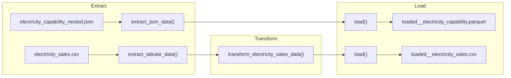

# ⚡ Powering Data for the Department of Energy — ETL Pipeline


A modular Python **Extract, Transform, Load (ETL)** pipeline built to ingest, clean, and structure U.S. Department of Energy electricity datasets (capability and sales) into analytics-ready CSV and Parquet formats.

---

## 🏗️ Pipeline Architecture



---

## 📂 Project Structure

```text
etl_pipeline_for_department_of_energy/
├── pyproject.toml                             # Project metadata & dependencies (managed by uv)
├── uv.lock                                    # Locked dependency versions
├── README.md                                  # Project documentation
├── data/
│   ├── raw/                                   # Raw input datasets
│   │   ├── electricity_capability_nested.json
│   │   └── electricity_sales.csv
│   └── processed/                             # Transformed & loaded output datasets
│       ├── loaded__electricity_capability.parquet
│       └── loaded__electricity_sales.csv
└── src/
    └── etl_department_of_energy/
        ├── __init__.py
        ├── main.py                            # Pipeline entrypoint & orchestration
        ├── extract/
        │   └── extractors.py                  # Tabular (CSV/Parquet) & nested JSON extractors
        ├── transform/
        │   └── transformers.py                # Data cleaning, filtering, and feature extraction
        └── load/
            └── loader.py                      # CSV and Parquet data writer
```

---

## 🔄 ETL Workflow

### 1. Extract (`extract/extractors.py`)
* **`extract_tabular_data(file_path)`**: Reads structured `.csv` or `.parquet` files into a Pandas `DataFrame` and raises a `ValueError` for unsupported formats.
* **`extract_json_data(file_path)`**: Loads and flattens semi-structured nested JSON records using `pd.json_normalize()`.

### 2. Transform (`transform/transformers.py`)
* **`transform_electricity_sales_data(raw_data)`**:
  * Drops records with missing values (`NaN`) in the `price` column.
  * Filters records to retain only the **`residential`** and **`transportation`** sectors (`sectorName`).
  * Parses the `period` field into dedicated `year` and `month` columns.
  * Selects and orders the target schema: `["year", "month", "stateid", "price", "price-units"]`.

### 3. Load (`load/loader.py`)
* **`load(dataframe, file_path)`**: Persists processed DataFrames to disk as either `.csv` (without index) or `.parquet` based on the destination file extension.

---

## 🚀 Getting Started

### Prerequisites
* **Python 3.14+**
* **[uv](https://docs.astral.sh/uv/)** for fast environment and dependency management

### Installation

1. **Clone the repository:**
   ```bash
   git clone <repository-url>
   cd etl_pipeline_for_department_of_energy
   ```

2. **Install dependencies with `uv`:**
   ```bash
   uv sync
   ```

### Running the Pipeline

Run the pipeline from the package directory:

```bash
cd src/etl_department_of_energy
uv run python main.py
```

Processed datasets will be written to `data/processed/`:
* `data/processed/loaded__electricity_capability.parquet`
* `data/processed/loaded__electricity_sales.csv`
